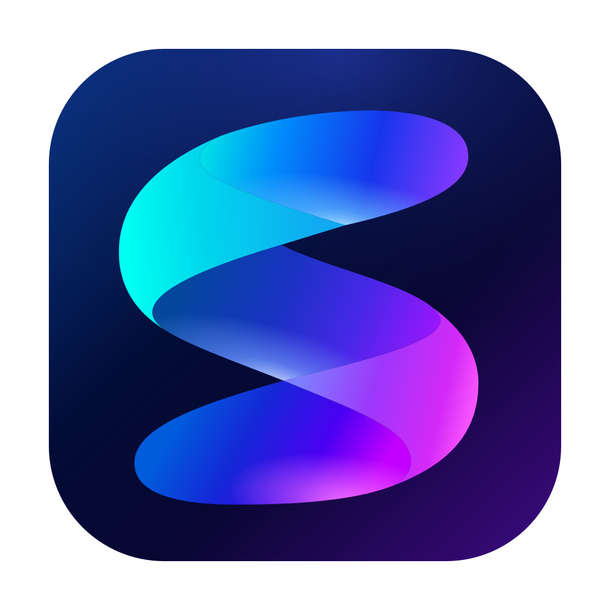

<p align="center">
  
</p>

<h1 align="center">Systra</h1>

<p align="center">A native macOS system monitor that helps explain what your Mac is doing.</p>

Systra brings system metrics, applications, background services, and individual processes into one interface. Start with the dashboard, inspect an application's resource usage in the sidebar, or keep the metrics you care about in the menu bar.

**macOS 14+ · Apple Silicon · SwiftUI + AppKit · English and Russian**

## Features

- **System monitoring:** CPU, memory, GPU, disk reads and writes, network throughput, and temperatures.
- **Applications and processes:** expandable process groups, search, sorting, and configurable columns. Background and menu bar apps are included.
- **Application summaries:** CPU and memory history, process roles, version, executable path, and uptime. Browser processes are grouped into web content, extensions, GPU, and network services.
- **Process controls:** open an app or its folder, copy details, restart, quit, or force quit. Multiple selection is supported; termination actions require confirmation.
- **Menu bar:** a compact popover and configurable metrics beside the icon, including CPU, memory, GPU, chip temperature, disk activity, network traffic, and uptime. An icon-only mode is also available.
- **Temperatures:** readable component groups, reading ranges, and individual sensors. Hover over a sensor to see its original macOS name.
- **System uptime:** time since boot, awake and sleep time, boot date, wake events, load averages, and Mac information.
- **Preferences:** English and Russian, light and dark appearances, system appearance, tab animations, and launch at login.

Closing the window or pressing **⌘W** removes Systra from the Dock while monitoring continues in the menu bar. To exit completely, choose **Systra → Quit Systra**. Open Settings with **⌘,**.

## Installation

1. Download `Systra-<version>-build<build>-macOS-arm64.zip` from [Releases](../../releases).
2. Extract the archive and move `Systra.app` to **Applications**.
3. Open the app.

The current build supports **Apple Silicon (M1 and later)**. It uses a local ad-hoc signature and is not Developer ID signed or notarized by Apple. macOS may require additional confirmation when opening a downloaded build for the first time.

## Privacy and measurement details

Metrics are processed locally. Systra does not send telemetry to a server, include analytics, or install privileged background services. Launch at login uses the native macOS mechanism.

A few details matter when interpreting the numbers:

- System CPU usage is normalized across the entire Mac. In application and process rows, **100% means one logical core**.
- The primary memory metric is **footprint**, including compressed pages. **RSS** measures resident pages. Shared pages may be counted by more than one process.
- Process disk counters may differ from physical SSD activity because of caching. Network traffic is measured across physical interfaces; VPN and loopback traffic are not added separately.
- Temperatures use a read-only HID API. Available sensors and GPU counters depend on the Mac model and macOS version. Missing data is shown as a dash.
- Browsers do not expose a reliable mapping between PIDs and named tabs. Systra reports actual process roles without inventing tab names. Per-application GPU and network attribution is not currently available.

Metrics update every two seconds. Charts retain up to two minutes of history from the current session. Process arguments are used locally to identify roles and are not stored in full.

## Building from source

You need Xcode with the macOS 26 SDK or later, Command Line Tools, and Python 3. The build has been verified with Xcode 27.1. There are no external package dependencies.

Open `Systra.xcodeproj`, select the **Systra** scheme and **My Mac**, then choose Run. Alternatively, from the project directory:

```sh
./build.sh
./run.sh
```

`build.sh` creates an arm64 Release build and installs it at `/Applications/Systra.app`. The shared Xcode scheme also installs the app after building. Building alone does not close an already running instance; `run.sh` restarts the installed copy.

To package a verified build:

```sh
python3 Tools/package_release.py
```

The archive and checksum are written to `.build/releases/`. The packager checks the signature and architecture, extracts the archive into a temporary directory, and verifies the extracted app again.

## Validation

```sh
./test.sh
SYSTRA_LIVE_CHECKS=1 ./test.sh
```

Checks cover metric sorting and aggregation, row selection, process and sensor classification, localization, menu bar preferences, login item states, uptime, and tab geometry. Optional live checks briefly launch a dedicated test process under load.

## Project structure

| Directory | Contents |
| --- | --- |
| `Sources/SystraApp` | Interface, monitoring, processes, preferences, and menu bar |
| `Sources/SensorBridge` | Read-only C bridge to libproc and HID sensors |
| `Resources` | Icons, translations, and application metadata |
| `Tests` | Executable validation checks |
| `Tools` | Installation, release packaging, and project generation |
| `Docs` | Design notes and release notes |

`Tools/generate_project.py` regenerates the Xcode project and shared scheme from the repository files. It does not run during normal builds.

Developed by **Arsen Kocharyan**. Design notes and workflow attribution are available in [Docs/Design.md](Docs/Design.md).
